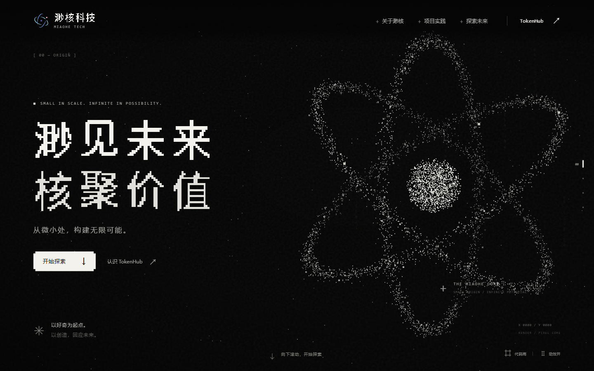

<div align="center">
  
</div>

<h1 align="center">渺核科技官网首页 · 渺见未来，核聚价值</h1>

<p align="center">
  
  
  
</p>
<p align="center">
  
  
  
  
</p>

东莞市渺核科技有限公司的品牌官网首页。v2.0.0 通过四个连续场景介绍品牌理念，并提供 [GDMU-NA TokenHub](https://tokenhub-tunnel.apps.gdmuna.com/) 项目的访问入口。页面使用原生 HTML、CSS、JavaScript 和 Canvas 2D；运行时不依赖第三方库、API 密钥或在线字体。

本项目包含：

- 品牌首页、关于渺核、项目实践和探索未来四个场景。
- 像素标题、程序化粒子、字符雨与概念终端等视觉表达。
- 桌面和移动端导航、动效控制，以及可独立部署的单文件页面。

## 🔥 开始

**环境要求：** 查看页面只需现代浏览器；运行本地预览、测试或构建需要 Node.js 18 或以上。项目没有 npm 依赖，无需执行 `npm install`。

```bash
git clone https://github.com/ReLuckyLucy/miaokernel-index.git
cd miaokernel-index
npm start
```

在浏览器打开 `http://localhost:4173`。本地预览服务器仅监听 `127.0.0.1`。也可以下载 [v2.0.0 静态站点 ZIP](https://github.com/ReLuckyLucy/miaokernel-index/releases/download/v2.0.0/miaohe-tech-v2.0.0-site.zip)，解压后直接打开其中的 `index.html`。

## 📜 内容与输入

本站不使用数据集或实时业务接口。企业名称、口号、项目名称、定位和项目网址的来源记录在 [docs/sources.md](docs/sources.md)。页面中的终端与链路图是概念示意，不代表 TokenHub 的实时运行状态；项目外链指向独立站点。

页面中的 `MIAOHE TECH` 仅用于视觉展示，不作为法定英文名称声明。延展品牌文案在正式上线前仍需企业确认。

要修改首页文案或项目入口，编辑 `index.html`；项目网址还需同步修改 `js/core.js`。更换点阵标题时，检查对应 SVG 图片的 `alt` 文本和标题的 `aria-label`。

## 🔛 运行与构建

```bash
npm test
npm run build
```

`npm test` 运行 5 项 Node 测试；`npm run build` 从源码生成 `dist/index.html`，将样式、脚本和 SVG 资源内嵌为一个文件。生成的页面可直接打开，也可放入静态网站根目录托管。

## 🪦 结果

以下是 v2.0.0 单文件页面在 Microsoft Edge 中打开后的首页截图：

<div align="center">
  
</div>

发布前的复验记录在 [docs/verification.md](docs/verification.md)：5 项 Node 测试通过；构建成功；桌面和移动视口的页面结构、导航及主要交互通过检查；解压后的页面已在 Edge 中通过 `file://` 打开。公开域名部署、Safari、Firefox、实体手机及 TokenHub 服务状态尚未验证。

## 📁 项目结构

```text
miaokernel-index/
├── README.md             # 项目说明
├── index.html            # 四场景页面结构与文案
├── styles.css            # 页面样式与响应式布局
├── js/                   # 基础配置、交互与 Canvas 视觉
├── assets/               # 品牌标记和点阵标题 SVG
├── scripts/build.mjs     # 生成单文件静态页面
├── server.mjs            # 本地预览服务器
├── tests/                # Node 与浏览器检查
├── docs/                 # 首页截图、来源及验证记录
└── dist/index.html       # 构建后的单文件页面
```

## 📦 版本归档

- [v2.0.0 Release](https://github.com/ReLuckyLucy/miaokernel-index/releases/tag/v2.0.0) 提供 GitHub 源码快照和可直接部署的静态站点 ZIP。
- [v1.0.0 Release](https://github.com/ReLuckyLucy/miaokernel-index/releases/tag/v1.0.0) 保留旧版 Vite、React、TypeScript 官网实现。

两个版本使用不同的页面实现。部署 v2 时使用对应 Release 的静态站点 ZIP；仓库 `main` 分支用于后续文档和代码更新。
仓库目前未启用 GitHub Pages。
